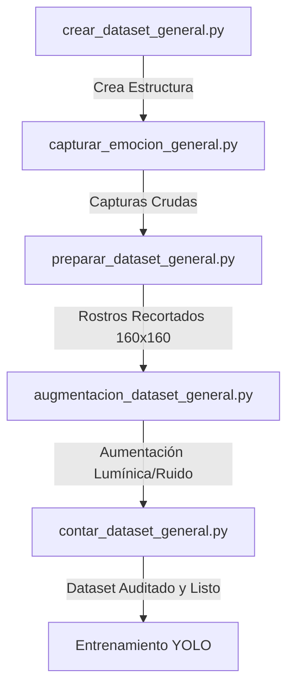

# 🧠 Sentiment-Lens YOLO: Pipeline de Adquisición y Procesamiento de Microexpresiones para Evaluación Psicológica Web

Un pipeline profesional de Machine Learning diseñado para la recopilación, segmentación, curación y aumentación de datasets de microexpresiones faciales en contextos de evaluación clínica y psicométrica en línea (como los test **PSS-10** de estrés, **GAD-7** de ansiedad y **PHQ-9** de depresión).

El objetivo principal es capturar respuestas gesticulares sutiles bajo las condiciones lumínicas reales del monitor de una computadora, procesarlas descartando información de fondo irrelevante, y estructurar un dataset óptimo listo para el entrenamiento de un clasificador **YOLO Classification (Ultralytics)**.

---

## 📋 1. Requisitos Previos y Arquitectura de Carpetas

### Requisitos de Software y Hardware
Para asegurar la correcta ejecución del pipeline y la aceleración por hardware durante el futuro entrenamiento, se requiere:

*   **Sistema Operativo:** Windows 10/11 (64-bit).
*   **Python:** Versión `3.12` (x64 recomendado).
*   **Aceleración Gráfica (GPU):** Tarjeta NVIDIA con soporte para **CUDA 12.8**.
*   **Librerías Clave:** `PyTorch`, `Ultralytics (YOLOv8/v11)`, `OpenCV-Python` y `Albumentations`.

---

### 🗂️ Estructura del Proyecto
El pipeline organiza los datos en una estructura modular. La carpeta base del dataset es `optencion_dataset`, dividida en capturas crudas (`capturas/`) organizadas por voluntario y el dataset clasificado final procesado (`final/`) dividido en `train`, `val` y `test` para las **5 clases emocionales de interés clínico**:

```text
optencion_dataset/
├── entorno/                           # Entorno virtual de Python (.venv)
├── optencion_dataset/                 # Carpeta base del dataset
│   ├── capturas/                      # Imágenes de origen (captura directa de webcam)
│   │   ├── voluntario_1/
│   │   │   ├── angry/
│   │   │   ├── bored/
│   │   │   ├── neutral/
│   │   │   ├── sad/
│   │   │   └── surprise/
│   │   └── ...
│   └── final/                         # Dataset procesado y segmentado (160x160px)
│       ├── train/                     # Set de entrenamiento (70% - 80% recomendado)
│       │   ├── angry/
│       │   ├── bored/
│       │   ├── neutral/
│       │   ├── sad/
│       │   └── surprise/
│       ├── val/                       # Set de validación (10% - 15% recomendado)
│       │   ├── angry/
│       │   ├── bored/
│       │   ├── neutral/
│       │   ├── sad/
│       │   └── surprise/
│       └── test/                      # Set de prueba (10% - 15% recomendado)
│           ├── angry/
│           ├── bored/
│           ├── neutral/
│           ├── sad/
│           └── surprise/
├── src/                               # Scripts del Pipeline
│   ├── crear_dataset_general.py       # Inicialización de la estructura de directorios
│   ├── capturar_emocion_general.py    # Módulo de captura en tiempo real por webcam
│   ├── preparar_dataset_general.py    # Detección de rostros, recorte y limpieza de fondo
│   ├── augmentacion_dataset_general.py # Técnicas de aumentación sintética de luz/ruido
│   ├── contar_dataset_general.py      # Script de auditoría de balance de clases
│   ├── entrenar_emociones_general.py  # Script de entrenamiento YOLO
│   ├── validar_emociones_general.py   # Script de validación cuantitativa
│   └── webcam_emociones_general.py    # Test inferencia en tiempo real
└── README.md                          # Guía técnica e instrucciones de operación
```

---

## ⚙️ 2. Configuración del Entorno (Consola de Comandos)

Siga estos comandos secuenciales en su terminal (PowerShell en modo Administrador si es necesario) para inicializar su entorno de desarrollo.

### Paso A: Creación del Entorno Virtual
Inicialice un entorno virtual aislado en la carpeta raíz del proyecto para evitar conflictos de librerías globales:

```bash
python -m venv entorno
```

### Paso B: Activación Segura en Windows (PowerShell Bypass)
Debido a las políticas de ejecución restrictivas predeterminadas de PowerShell en Windows, ejecute el comando de bypass para permitir la carga del script de activación en la sesión actual y proceda a activarlo:

```powershell
# Omitir de forma segura la política de ejecución en la sesión actual de PowerShell
Set-ExecutionPolicy -Scope Process -ExecutionPolicy Bypass

# Activar el entorno virtual
.\entorno\Scripts\Activate.ps1
```

> [!NOTE]
> Una vez activado el entorno, el prefijo `(entorno)` aparecerá al principio de su prompt en la línea de comandos.

### Paso C: Instalación de Dependencias Críticas
Instale primero la versión de PyTorch compilada con soporte nativo para **CUDA 12.8** de los servidores oficiales de PyTorch:

```bash
pip install torch torchvision torchaudio --index-url https://download.pytorch.org/whl/cu128
```

Posteriormente, instale las dependencias de Computer Vision, procesamiento de datos y la suite de Ultralytics en un comando consolidado:

```bash
pip install ultralytics opencv-python albumentations matplotlib pandas scipy
```

---

## 🔄 3. Flujo de Ejecución del Pipeline (Paso a Paso)

El pipeline de datos sigue un orden secuencial estricto diseñado para pasar de la creación física del espacio de almacenamiento al conteo de muestras listas para entrenamiento.



### Paso 1: Inicialización de Directorios
Ejecute este script para crear automáticamente el árbol de directorios requerido dentro de `optencion_dataset/` asegurando que no existan errores de rutas inexistentes durante la captura o el preprocesamiento:

```bash
python src/crear_dataset_general.py
```

### Paso 2: Captura de Imágenes Crudas por Webcam
Este script abre un feed de video en tiempo real de su webcam. Capture ráfagas de gestos faciales interactuando directamente con el teclado.

```bash
python src/capturar_emocion_general.py --clase <emocion> --persona <nombre>
```

**Ejemplo Práctico:**
```bash
python src/capturar_emocion_general.py --clase neutral --persona voluntario1
```

#### 🎮 Controles de Teclado del Script de Captura:
*   **Tecla `S` (Save):** Guarda el fotograma actual de la webcam en formato `.jpg` dentro del directorio `optencion_dataset/capturas/<nombre>/<emocion>/`.
*   **Tecla `Q` (Quit):** Cierra el feed de la cámara web, guarda el buffer y finaliza la ejecución de forma segura.

---

## 🎭 4. GUÍA CRÍTICA: Cómo Realizar los Gestos Faciales (Manual de Actuación Clínico)

> [!IMPORTANT]
> **ESTRICTAMENTE NO EXAGERAR LAS GESTICULACIONES.** 
> En los cuestionarios de evaluación psicológica reales (como PHQ-9 o GAD-7), los pacientes no realizan expresiones teatrales. Los microgestos reales son sutiles, veloces y atenuados. Capturar muecas exageradas generará un *data drift* severo que provocará que el modelo falle por completo al ser desplegado en producción web real.

Pida a los voluntarios que interactúen mirando directamente al monitor, situando su cabeza a diferentes distancias (entre 45 y 70 cm de la pantalla) y moviendo sutilmente la cabeza (inclinación lateral leve de ±5°), simulando que leen con atención las preguntas.

---

### 🎨 Manual de Pose por Clase Emocional

| Emoción (Clase) | Gesto Clínico Esperado | Instrucciones de Actuación para el Voluntario |
| :--- | :--- | :--- |
| **`neutral`** | Rostro en reposo absoluto durante la lectura fluida. | Mantén la mirada fija en el texto simulado. Relaja los músculos de las mejillas, la mandíbula y el entrecejo. Labios juntos y en posición horizontal neutra. |
| **`bored`** | Fatiga cognitiva, desinterés o aburrimiento extremo ante la longitud del test. | Párpados ligeramente caídos ("ojos cansados"). Mirada sutilmente dispersa o desenfocada de la línea exacta de lectura. Permite una leve inclinación lateral del cuello o apoya ligeramente la barbilla sobre la mano. |
| **`sad`** | Respuesta empática a preguntas tristes o desánimo clínico (PHQ-9). | Descenso muy sutil y suave de las comisuras de los labios. Ligera pérdida de tensión en las cejas. Mirada dirigida sutilmente hacia la mitad inferior de la pantalla (donde estarían las opciones de respuesta). |
| **`angry`** | Frustración ante preguntas difíciles, sobrecarga cognitiva o estrés (PSS-10). | Contracción sutil del entrecejo (ceño ligeramente fruncido). Tensión imperceptible en los labios (apretando levemente las comisuras hacia adentro). Párpados firmes. |
| **`surprise`** | Reacción espontánea o sobresalto ante una pregunta inesperada o reveladora. | Apertura de ojos levemente mayor a la habitual. Elevación suave y sutil de la parte media de las cejas. La boca puede abrirse de manera imperceptible o relajar la mandíbula inferior sin llegar a abrir la boca ampliamente. |

---

### 💡 Simulación de Iluminación y Variabilidad
*   **Luz del Monitor:** Capture imágenes variando el brillo de la pantalla. Use fondos de pantalla blancos (simulando interfaces de "modo claro" de la aplicación web) y fondos negros (simulando "modo oscuro") para capturar los cambios correspondientes en la reflectancia y colorimetría del rostro del voluntario.
*   **Variabilidad Física:** Capture muestras con y sin anteojos (si el voluntario los usa habitualmente), diferentes peinados que puedan ocluir parcialmente la frente, y ligeras rotaciones de la cara.

---

## 🛠️ 5. Procesamiento, Aumentación y Auditoría del Dataset

Una vez recopiladas las capturas crudas, se ejecuta la fase automatizada del pipeline para preparar los datos para la arquitectura YOLO Classification.

### Paso 3: Segmentación y Recorte de Rostros
Este script limpia el dataset eliminando el ruido del entorno de fondo (habitaciones, muebles) y estandarizando las dimensiones de las imágenes.

```bash
python src/preparar_dataset_general.py
```

*   **¿Cómo funciona internamente?**
    1.  Carga secuencialmente las imágenes de `optencion_dataset/capturas/`.
    2.  Implementa clasificadores **Haar Cascades** de OpenCV para detectar con precisión las coordenadas del rostro humano.
    3.  Aplica un margen adaptativo alrededor del rostro, recorta y elimina por completo el fondo de la habitación.
    4.  Redimensiona la imagen facial resultante a una resolución uniforme de **160x160 píxeles** en escala de color RGB.
    5.  Distribuye las muestras resultantes de manera estratificada en las carpetas `train`, `val` y `test` dentro de `optencion_dataset/final/`.

---

### Paso 4: Aumentación de Datos Sintética
Para evitar el sobreajuste (*overfitting*) debido a la baja variabilidad lumínica y simular los diferentes monitores y webcams del mercado, aplique transformaciones geométricas y fotométricas robustas.

```bash
python src/augmentacion_dataset_general.py
```

*   **Técnicas aplicadas mediante Albumentations:**
    *   **Simulación de Modos Web (Claro/Oscuro):** Modificaciones aleatorias de brillo y contraste adaptativo (`RandomBrightnessContrast`).
    *   **Distorsión de Webcam:** Añadido de ruido Gaussiano leve (`GaussNoise`) simulando sensores de cámara de baja calidad.
    *   **Variación de Enfoque:** Desenfoque de lente sutil (`MotionBlur`).
    *   **Incertidumbre de Encuadre:** Escalamiento, rotación fina (±10 grados) y traslación leve.

> [!WARNING]
> La aumentación solo se debe aplicar a las carpetas del set de **entrenamiento (train)**. Las imágenes de validación y test deben permanecer limpias de alteraciones artificiales para garantizar métricas de precisión confiables y reales.

---

### Paso 5: Auditoría y Balance del Dataset
Antes de iniciar el entrenamiento del modelo de Deep Learning, es crítico auditar el estado del dataset y verificar que las clases no presenten desbalances extremos que puedan sesgar al clasificador.

Ejecute el script de conteo para obtener un reporte estructurado en consola del volumen de datos:

```bash
python src/contar_dataset_general.py
```

*   **Salida Esperada en Consola:**
    El script imprimirá una tabla detallando el conteo de muestras por clase y subdirectorio:

    ```text
    ============================================================
    AUDITORÍA DEL DATASET: optencion_dataset/final
    ============================================================
    DIRECTORIO   | ANGRY | BORED | NEUTRAL | SAD | SURPRISE | TOTAL
    -------------+-------+-------+---------+-----+----------+------
    train/       |   350 |   350 |     380 | 340 |      320 |  1740
    val/         |    50 |    50 |      60 |  50 |       45 |   255
    test/        |    50 |    50 |      50 |  50 |       45 |   245
    -------------+-------+-------+---------+-----+----------+------
    TOTALES      |   450 |   450 |     490 | 440 |      410 |  2240
    ============================================================
    ```

---

## 🚀 6. Siguientes Pasos
Una vez ejecutados los 5 pasos del pipeline y validada la distribución balanceada de las imágenes, el dataset está listo para el entrenamiento.
Puede comenzar el entrenamiento ejecutando:

```bash
python src/entrenar_emociones_general.py
```

> **Consejo:** Conserve las carpetas originales en `capturas/`. Si nota falsos positivos en producción sobre alguna expresión en específico, puede modificar el script de preparación o aumentación directamente en el código de origen y regenerar la carpeta `final/` sin necesidad de volver a convocar a los voluntarios para una sesión de fotos.
